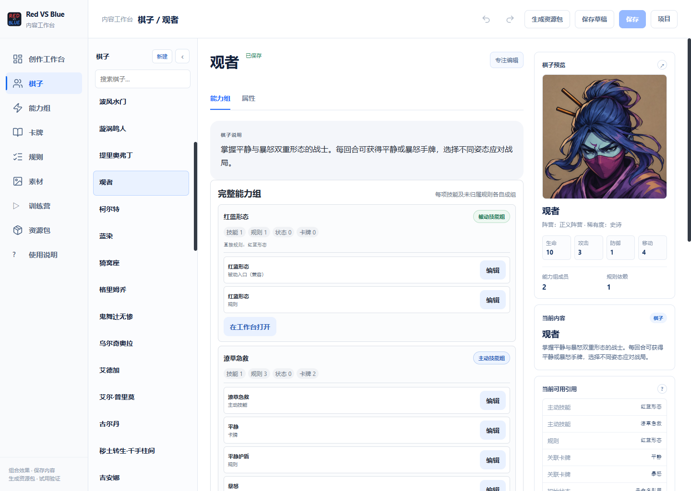
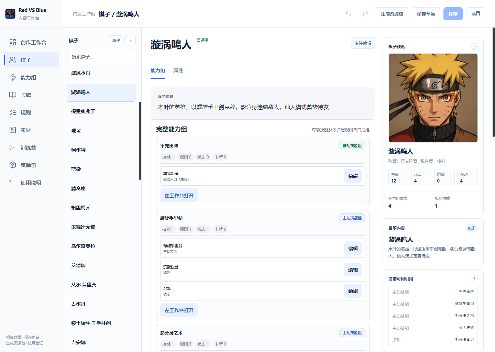
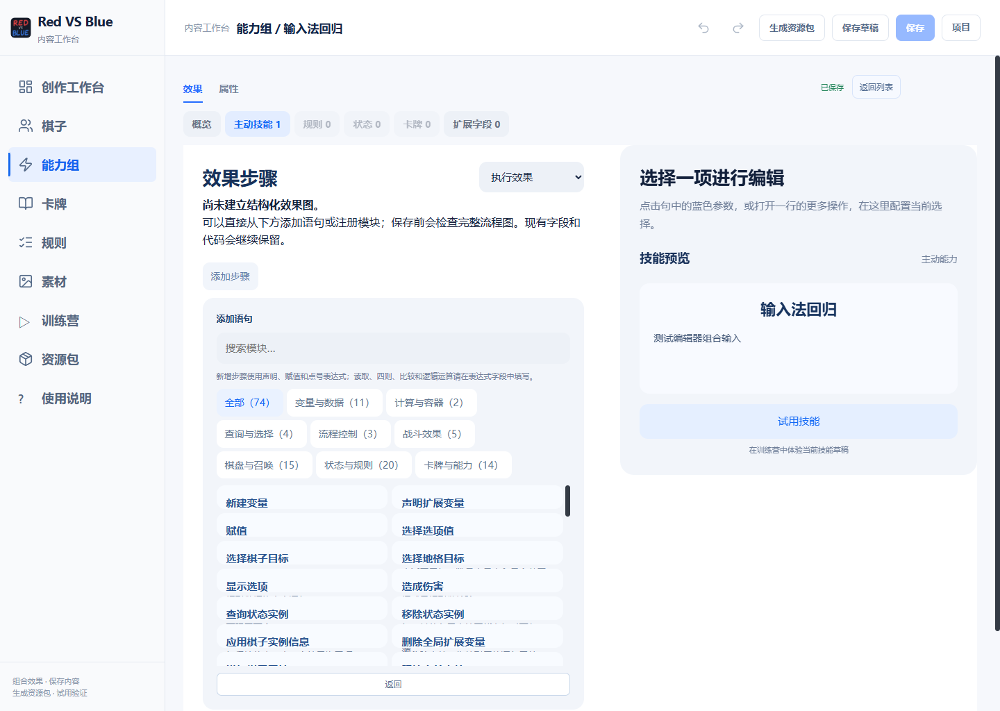
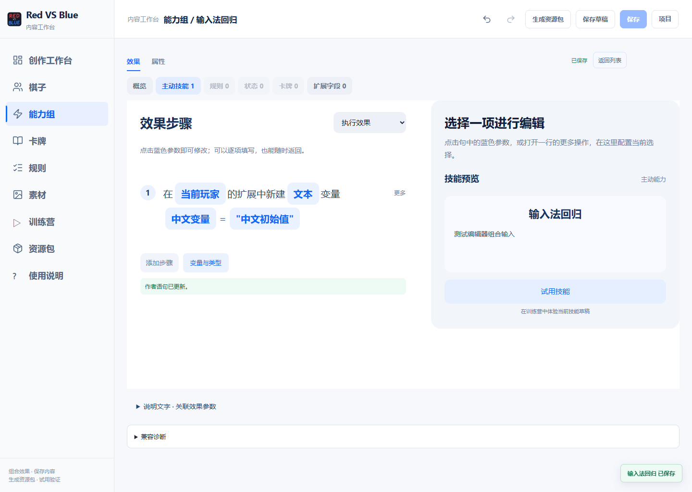

# RED-252：中文输入、显式结果与统一语句验收修复

## 本批合同

- 目标：修复人工验收发现的中文输入卡住、选择结果未保存却能读取“目标”、新增语句目录仍暴露按宿主拆分的读写模块。
- 基线：`main`，`082166c6b803b2e838bce5f0f6824c5bbc714dd6`；本批开始已 fetch 并执行基线检查。
- 风险：Medium。范围为编辑器输入、句子目录、作者语句编译、关联测试、说明书与生成包；不修改游戏规则、数值、随机算法或用户验收项目。
- 排除：不以本批验证替代所有棋子玩法的完整验收，不更新用户正在编辑的内容，不合并或发布。
- 验收：中文组合输入保留输入节点和文本；非组合状态仍可补全；新增变量只有统一声明与赋值入口；表达式读取字段；选择结果只能按显式保存的名字引用；保存重开后保持行为。
- 用户追加：保留“保存返回值”，使用明显按钮，在同一位置显示类型并新建真实局部变量，正文说明存入位置，变量可以在后续引用和赋值。旧命名结果兼容保留。
- 后续批准范围：卡牌、技能、规则、状态、能力组和地格效果实例扩展；逐完整能力归组；描述可直接读取扩展变量与只读表达式。必要接口位于 lib/skill-graph、lib/game、electron-editor、普通内容与 data/pages 显示链路。维伦死亡不取消预言依此前已批准说明修正；不扩展冒险、存档、随机、费用或经济。
- Linear：RED-252；PR：<https://github.com/longaadream/Red_VS_Blue/pull/240>。

## 复现与原因

1. 打开添加语句搜索框或表达式输入框，使用中文输入法连续拼写。旧界面会在输入事件中重建界面，或在组合输入尚未结束时触发表达式解析与候选替换。
2. 火球选择语句未保存返回值，下一句输入“目标”。旧表达式根名称将它解析成技能上下文目标，与刚才选择的返回值并非同一来源。
3. 添加语句的“变量与数据”目录列出玩家、棋子和全局的声明、读取、写入。目录直接展示底层模块，未落实统一作者语法。

## 实现边界

中文输入期间暂停输入框替换与编辑器快捷键；最终文本确认后恢复联想和必要刷新。统一作者语句编译为已有的受限读写模块，旧图仍可读取和编辑；删除“目标”的隐式表达式根，不删除旧图的运行模块。未声明的变量给出作者诊断。

赋值左侧的对象与索引只求值一次。修改映射或结构字段时重建值，再写回原先求得的宿主；不重复随机选择。可空类型允许赋空，不可空类型仍拒绝空值。字段写入继续受既有可写字段白名单约束，不能绕过位移机制直接写坐标。

## 验证记录

- 作者表达式、声明/赋值、扩展、容器相关 Vitest：76/76 通过。报告：`output/completion-unified-author-core.json`。
- TypeScript 检查通过；作者编译相关 ESLint 通过。
- 句式模板 Node 测试：27/27 通过。
- `node tests/electron/authoring-ime.test.mjs`：真实 Electron 中的组合输入、搜索连续输入、父级刷新、中文扩展声明应用/磁盘保存/重开通过。截图位于 `docs/qa/completion-unified-statements-smoke/`。
- `node tests/electron/author-statements-ui.test.mjs`：实际点击语句上下移动，单节点和多节点作者语句、普通行保持完整分组；编译运行结果随顺序分别为 2 和 1，目录保留副作用模块并隐藏底层读取与运算。
- 独立审查发现的随机接收者重复求值、可空赋值拒绝问题已复现、修复，10/10 语句回归独立复跑通过。
- “保存返回值”生产 Electron 回归通过：创建真实局部变量、修改并读取、中文名称、重复名称拒绝、失效关联释放名称（含同一效果的其他输出端口）、只读查看不锁住保存、磁盘保存与重开，以及手牌实例保存后使用统一扩展声明和赋值。
- 实例引用补充：局部变量保留卡牌/技能/规则/状态/能力组实例类型，元组索引后仍可访问实例扩展。`当前手牌` 的运行输出修正为冻结身份记录，符合既有记录类型；权威宿主继续接受旧字符串身份。真实两张同名圣光牌只有选中实例被改为倍率 2，另一张仍为 1；保存读取后分别计算出 10 和 5。
- 能力初始化补充：已属于技能能力组的直接规则不再额外生成单独规则组；未归属规则仍保留独立根，共享规则仍由已有所有权机制维护。相关规划、对局初始化和组生命周期 23/23 通过，报告 `output/completion-cluster-runtime-dedup.json`。初始失败复现了重复根，首次对局测试另因默认 5 秒超时，完整验证使用 30 秒预算；没有修改快照或压低断言。
- Electron 自动化使用合成 Chromium 组合输入事件；不能等同于 Windows 原生输入法候选窗口及物理键盘已验收。

## 能力分组与动态描述

普通棋子按每项完整能力显示，组内汇聚技能、规则、状态、卡牌、扩展声明和来源；定义引用不会自动授予状态或生成卡牌。静态整理覆盖 45 个普通棋子、142 个直接技能组；该统计不是 142 项玩法已逐一运行的证明。14 条辅助规则归入所服务的能力；共用成员保留共享关系，玩家规则仍装在玩家宿主。

独立审查复现了相关引用后代被错算为根能力拥有的规则：`a related→b owned→r` 会隐藏独立被动 r。修改前回归失败；修正后仅根自身明确 owned/shared 链接决定所有权，递归依赖仍可浏览。投影、初始化、真实对局相关 17/17 通过；最终作者表达式、语句、实例扩展、分组与从零产物运行 85/85 通过，见 `output/completion-input-core-final.json`。

描述共享作者表达式解析器，支持点号字段、扩展、元组一基索引、运算和登记的纯函数；结果按文字转义。缺失字段显示“未赋值”，返回诊断；不执行 getter、随机或效果，不靠轮询更新。状态详情、玩家规则提示和真实牌面沿既有快照更新重新渲染。每次插值只建立一次有预算的数据投影与索引，过大输入有限退出；不是每个占位符扫描整份战局。

独立审查修复元组错误使用零基索引与投影重复扫描。相同独立探针中 100 个实例/记录、256 个常量占位符从约 5464ms 降至约 5ms；5000 个实例/记录触发预算诊断，不无限扫描。渲染与句式 Node 测试 40/40 通过。flowState、状态、牌面、玩家规则快照→DOM 共 34 项中 33 通过；唯一失败为 HEAD 已存在的 `_preferredInitialZoom / widthCoverageZoom` 渲染器源码断言，渲染器本批未改，未放宽断言。实际描述编辑、保存和重开 Electron 测试通过；动态训练营验证单独记录。

## 最终候选验证与明确边界

- 真实扁平工作台 13/13 通过（`output/completion-flat-sentence-final`）；旧底层菜单版本测试改为验证统一声明/赋值、表达式成员访问，以及旧图仍能读写。未恢复隐藏的读取/运算菜单。
- 真实动态训练营通过（`output/completion-description-training-smoke`，种子 594）：实际编辑技能、玩家规则及圣光牌描述，保存、进程重启重开、正式训练快照；施放月神赐福写入权威扩展，玩家规则提示从“未赋值”变为 1.5，新生成圣光惩击牌面显示“圣光伤害提高1.5倍”。不是直接调用插值器冒充游戏执行。种子决定此例生成圣光惩击，测试明确断言该牌。
- 最终资源包生成、安装、更新、重启、回退及篡改拒绝 1/1 通过，280.564 秒（`output/completion-input-description-pack-final.json`）。发布为本地测试替身，没有真实发布。
- 扩大作者/模块/普通内容回归：1300 项中 1299 通过，1 项全量能力组审计同步运行耗时 34.467 秒、超出 30 秒预算。保留原报告，不称该次全绿。该审计单独序列化、60 秒预算运行 4/4 通过（`output/completion-cluster-audit-final.json`）；没有改测试断言、降低规模或重复同配置刷结果。其余 1299 项不再重复跑。
- 扩测最初另有 11 项原子样例 harness 使用无先前图的冻结目标声明，被严格绑定校验拒绝。生成输入改为正式文档已有图，冻结数据仍用于原始规则依赖；没有放宽生产校验。原 17 项行为断言与目标绑定合计 33/33 通过。维伦死亡 corpus 则明确保留已批准的新语义，118/118 通过；无关死者分支额外断言预言及消息与旧版完全一致，独立审查关闭过滤器测试缺口。
- 完整 TypeScript、限定排除两份原有未跟踪临时文件的全目录 ESLint、编码检查、编辑器编译/共享包/打包 worker、Windows 游戏引擎构建通过。最后正式对局设置 4/4 通过。独立审查本批发现均已关闭。

以上证明本批作者交互、实例身份、完整分组和动态描述链路，不代表原生 Windows 输入法候选窗口或所有棋子玩法已获人工体验验收。历史渲染器 zoom 正则失败仍保留。未归属的 `data/rules/ai-semantics.json` 一字符工作树差异、其他已有 QA 图片与临时文件不纳入本批提交，不覆盖这些共享改动。

## 人工验证

1. 在语句搜索中连续输入两段中文，确认不丢焦点、不必重新点击输入框。
2. 新建文本扩展变量，中文输入名称和带引号的初值。输入法选字期间按回车或退出，不应提交或关闭编辑器；完成后应用，保存并重开。
3. 创建选择语句但不保存结果，后续输入“目标”应提示未声明；保存为自己指定的名字后可引用。
4. 新建数值扩展变量“计数”，赋值为 `当前玩家.扩展变量.计数 + 1`；确认正文显示统一声明/赋值句式，目录按用途分类。
5. 调整相邻赋值语句顺序，检查显示顺序、保存结果和运行顺序一致。
6. 在描述插入 `{当前手牌.扩展变量.伤害量}`，使用真实实例在训练营改变数值，核对牌面、状态或玩家规则提示刷新；缺失变量应显示“未赋值”。
7. 在棋子能力组页打开某项能力，检查辅助规则、状态和生成卡牌都能按来源进入编辑；共享定义不应被自动生成或错误移除。

## 回退

只回退本批提交并重新生成编辑器共享包。旧原子图模块继续保留；不回退或覆盖其他未提交文件，不删除用户项目或草稿。
